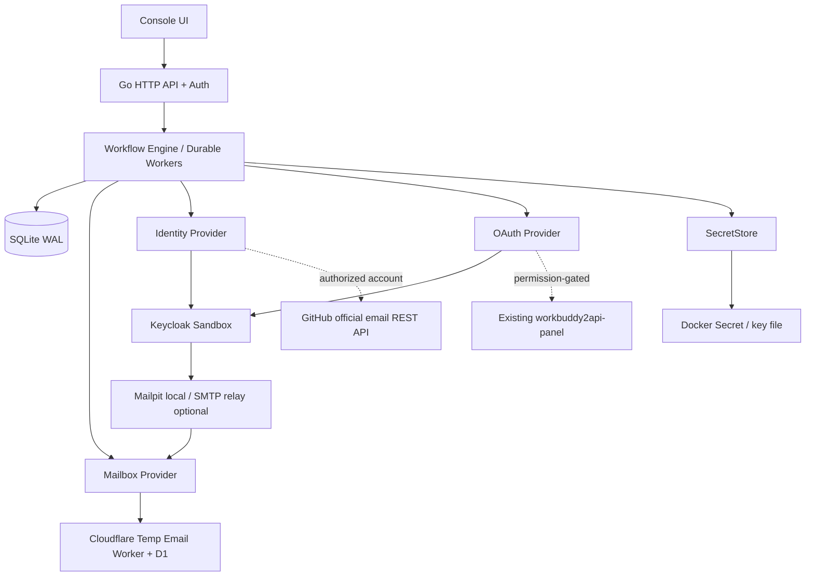

# 02 架构设计

## 总览

## 核心组件责任

- **API**：操作者认证、校验参数、幂等键、任务管理、SSE 状态订阅。只处理控制面信息，不替平台同意授权。
- **Engine**：状态转移、检查前置条件、分发 Provider、锁、退避和恢复。不能依赖 HTTP 请求上下文维持长任务。
- **Provider**：隔离具体协议；配置白名单；超时/限流/错误映射，不返回凭据原文。
- **Store**：SQLite schema、单任务声明（lease）、步骤快照、事件流、Secret metadata。只有仓库访问层允许原子状态修改。
- **SecretStore**：保存 Cloudflare 管理密码、邮箱 JWT、Github 授权令牌等；OAuth 用户凭据则留在原持有者服务内部。
- **UI**：最小 React/Vite 或纯 HTML，依据现有项目偏好决定；不依赖 UI 自动化驱动工作流。第一版可先服务端 HTML + 少量 JS。

## 生产部署拓扑

- Cloudflare Temp Email 保持独立：`https://api.moonbyte.top`，原邮箱、D1 不迁移。
- Ubuntu Docker：`account-onboarding` 监听 `127.0.0.1:8788`；`workbuddy2api-panel` 保持私网入口，**不引入公网开放的管理 API**。
- SQLite 数据文件独立卷保存，部署先单实例；未来需要 HA 时迁移数据库与租约模型，不直接把一个 SQLite 文件多主共享。
- 非本机访问：通过 Tailscale / WireGuard / SSH port-forward。面板仍需鉴权。

## 两种执行拓扑

### Sandbox（全自动）

`Keycloak registration -> Mailpit SMTP -> mail API -> OTP/link extraction -> Playwright confirms -> Keycloak OAuth Authorization Code + PKCE -> credential validation -> complete`。

严格推荐将 **Mailpit** 作为默认本地 E2E 收件箱，确保 CI 完全脱网、确定性执行。真实 Cloudflare 邮件投递放在单独的可选 staging 测试中：需要可用 SMTP relay，不能假设 Cloudflare Email Routing 自带外发能力。

### Real-account（授权/人工参与）

`Cloudflare mailbox -> GitHub official email APIs (existing identity) -> WAITING_USER_ACTION -> verify=true -> optional permitted WorkBuddy auth start/poll -> complete`。

WorkBuddy 尚缺书面许可时，Adapter 默认关闭、契约测试使用 Fake。执行器不能因某个 Provider 不可用就偷偷替换为反代/抓包实现。

## 失败隔离原则

1. 外部 Provider 的慢/失败不能阻塞 API 请求线程。
2. SecretStore 失败必须 fail-closed，工作流不可写入明文兜底。
3. 外部副作用前标记 `STEP_STARTED` + 幂等上下文；副作用后写成功摘要，重启先做 reconciliation，避免重复执行。
4. OAuth `state` 不能重用；WorkBuddy 的现有 `state` 在原网关内存中，原网关重启后可能失效，必须返回 `REAUTHORIZE_REQUIRED` 而不是自动再次开始登录。
5. 不跨系统做假分布式事务。使用 saga / 补偿：测试邮箱与测试账户可在用户确认后删除，真实身份/Token 一律不自动删除。

## 性能估算与预算（不是实测）

- 默认同一时间执行 2 个任务，峰值 5；随机退避防止同时查询邮件。
- API P95 本地目标 < 300ms（不包括外部远程操作）。
- SQLite 事务 < 100ms 的目标应在 CI benchmark 验证；不能将目标当结果。
- Playwright/Keycloak 测试资源另计，不在单 Go 服务 256MiB 预算中。
