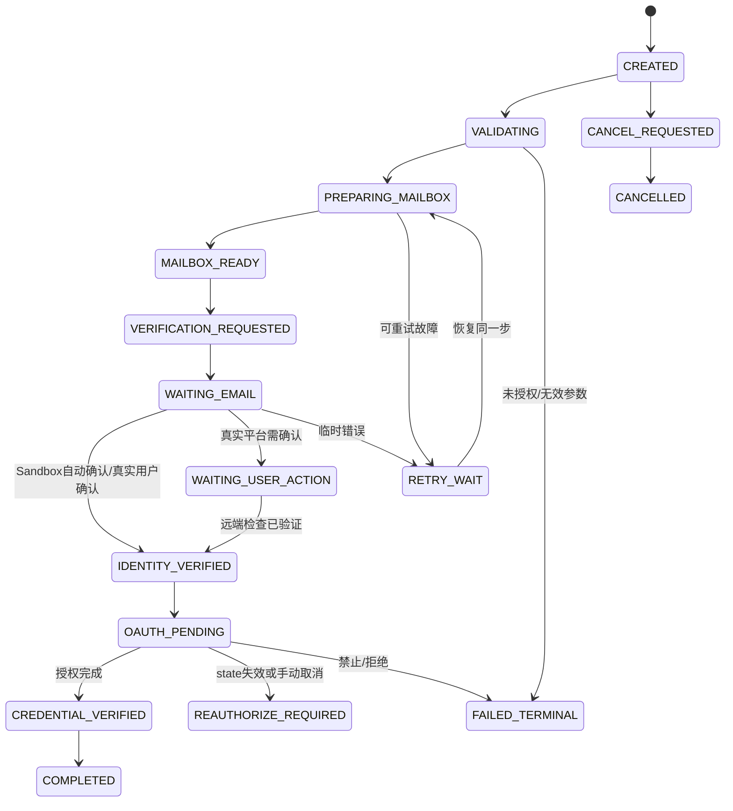

# 03 工作流状态机与可靠性

## 任务模板

- `sandbox-email-verify-oidc`：Keycloak + Mailpit，5 个控制内用户自动 E2E。`mode=sandbox-e2e`。
- `cloudflare-mail-smoke`：创建自有地址 -> 收件 -> 解析 -> 清理/保留策略。`mode=cloudflare-integration`。
- `github-existing-email`：已有 GitHub 用户为自己的账号添加地址（可选）-> 等待真人操作 -> REST API 验证。`mode=real-account`。
- `oauth-existing-account`：许可明确后可绑定现有账号 OAuth；否则 Fake Provider + `NOT_AUTHORIZED`。`mode=real-account`。

## 状态集合

```text
CREATED
VALIDATING
PREPARING_MAILBOX
MAILBOX_READY
VERIFICATION_REQUESTED
WAITING_EMAIL
WAITING_USER_ACTION
IDENTITY_VERIFIED
OAUTH_PENDING
CREDENTIAL_VERIFIED
COMPLETED
RETRY_WAIT
REAUTHORIZE_REQUIRED
FAILED_TERMINAL
CANCEL_REQUESTED
CANCELLED
```

工作流状态需与 `step.status` 分离；task `status` 代表用户能理解的最新进度，step `status` 代表单步执行结果。`WAITING_USER_ACTION` 不需要持续占用 worker lease。

## 典型转移



`FAILED_TERMINAL` 和 `CANCELLED` 为终态。`COMPLETED` 写入后只追加事件，不回滚。人为 resume 只对允许的等待或可恢复失败状态生效；不自动把 403 变成其他账户重试。

## 外部操作可靠性

- 幂等粒度：`(owner_id, template, idempotency_key)` 创建唯一约束；各 step 带 `operation_key=run_id:step_name:version`。
- 租约领取：SQLite `BEGIN IMMEDIATE` -> SELECT runnable -> compare/set `lease_owner`、`lease_until` -> COMMIT；执行外部调用在事务外。
- 认领超时：新 worker 可以重新领取，但在**任何非幂等远端副作用**前先读取 provider 的当前状态（reconciliation）。
- 并发：单容器最多 N 个 worker 协程；同一个 run 的 step 必须串行，避免两个 worker 同时对同一地址/身份执行写操作。
- 重试：指数退避（基础 2s，上限 120s，jitter ±20%），仅 NETWORK/TIMEOUT/429（遵守 Retry-After）/特定 5xx 可重试。401/403、验证拒绝、无许可、OAuth 用户取消和密钥失效进入终态或人工处理。
- OTP：只提取限定发件域、时间窗及匹配任务地址的邮件；不得在日志显示原文；每封信 `message_id` 仅消费一次；禁止把真实 GitHub 码用于无人工确认的账号创建。
- 绝对 deadline：整个 run 截止时间与单 step 超时分开；timeout 后不能假定远端操作失败，先对账。
- 取消：停止后续调用，释放租约，测试资源按显式策略补偿，不自动删除真实 GitHub 地址/WorkBuddy 账号。

## 事件（只追加）

`RUN_CREATED`, `STEP_STARTED`, `STEP_SUCCEEDED`, `STEP_RETRY_SCHEDULED`, `HUMAN_ACTION_REQUIRED`, `OAUTH_STARTED`, `OAUTH_EXPIRED`, `RUN_COMPLETED`, `RUN_FAILED`, `RUN_CANCELLED`。

事件 payload 严格 allowlist：`provider`, `resource_alias`, `http_status`, `latency_ms`, `failure_class`, `next_retry_at`；不包括邮箱正文、验证码、Authorization Header、`state` 原文、Token。

## 引擎伪代码

```go
func (e *Engine) Tick(ctx context.Context) error {
    claim, err := e.repo.ClaimNext(ctx, e.instanceID, time.Now().UTC())
    if err != nil || claim == nil { return err }
    result := e.executeStep(ctx, *claim) // NO SQLite transaction held here
    return e.repo.CommitStepResult(ctx, *claim, result)
}
```

`CommitStepResult` 必须校验 lease fencing token，旧 worker 提交被拒绝，并进行状态转移白名单校验。
